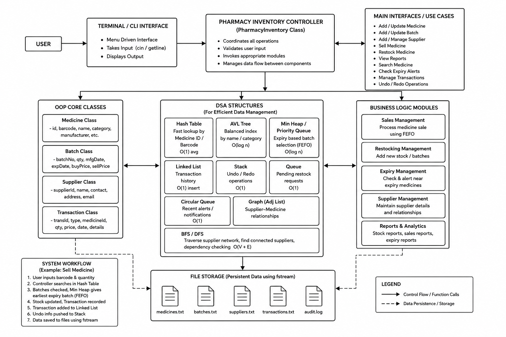
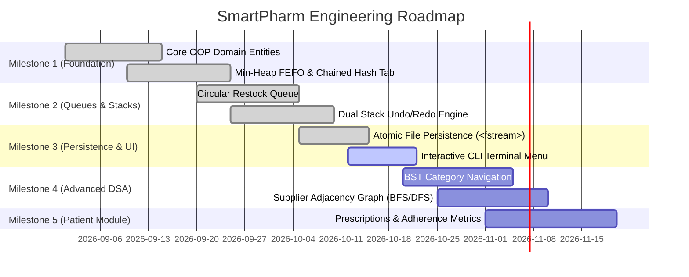

<div align="center">


# SmartPharm: Pharmacy Inventory & Supplier System
### Balanced Object-Oriented Programming (OOP) & Custom Data Structures & Algorithms (DSA) Implementation
**Course Project: Project-Based Learning (PBL) | Department of Computer Science & Engineering**  
**Graphic Era Hill University — Dehradun • Bhimtal • Haldwani**

---

[](https://en.cppreference.com/w/cpp/17)
[](https://gcc.gnu.org/)
[-orange)](https://mitpress.mit.edu/9780262046305/)
[](#4-oop-domain-modeling--dsa-integrations)
[-success)](#9-testing-and-validation-status)
[-blue)](#11-project-progress-and-member-task-matrix)

</div>

---

## 📌 Repository Description

> **SmartPharm** is a high-performance, terminal-based Pharmacy Inventory and Supplier Management platform written in **C++17**. It replaces error-prone manual paper registers and expensive closed-source proprietary ERP systems with a custom, console-based architecture. Every core inventory operation is backed by **custom, from-scratch data structures and algorithms** (Separate-Chaining Hash Table, Expiry-Based Binary Min-Heap, Array-Based Circular FIFO Queue, Pointer-Based Dual-Stack for Undo/Redo, and Doubly Linked Lists) paired with rigorous **Object-Oriented domain modeling** and atomic flat-file persistence.

---

## 👥 Student & Team Information

### **Team Name: Team Rocket**

| Member Photo | Full Name & University Credentials | Project Role & Assigned Subsystems |
| :---: | :--- | :--- |
|  | **Aditya Raj** *(Team Lead)*<br>• **University Roll No:** `2519270`<br>• **Student ID:** `25101286301`<br>• **Email:** [adityaraj82520@gmail.com](mailto:adityaraj82520@gmail.com) | **Batch Management & FEFO Min-Heap Engine**<br>• Custom array-based Min-Heap (`m1_batch.h` / `BatchMinHeap.cpp`) for First-Expire-First-Out batch prioritization.<br>• Multi-batch sales deduction and splitting logic.<br>• Automated near-expiry scanning and alert engine. |
|  | **Baibhab Gusain**<br>• **University Roll No:** `2519338`<br>• **Student ID:** `25103140029`<br>• **Email:** [baibhabgusain094@gmail.com](mailto:baibhabgusain094@gmail.com) | **Medicine Entity Hierarchy & Core Controller**<br>• Polymorphic Medicine base class and Tablet/Syrup/Injection hierarchy (`m2_medicine.h` / `Medicine.cpp`).<br>• Custom Separate-Chaining Hash Table ($O(1)$ avg) & Binary Search.<br>• Composition root controller (`PharmacyInventory`) & interactive CLI menu. |
|  | **Akshat Rawat**<br>• **University Roll No:** `2519282`<br>• **Student ID:** `25101210490`<br>• **Email:** [akshatrawat0876@gmail.com](mailto:akshatrawat0876@gmail.com) | **Supplier Management & Restock Pipeline**<br>• Supplier domain entity and custom array-based Circular FIFO Queue (`m3_supplier.h` / `Supplier.cpp`).<br>• Modulo wrap-around logic for non-starving restock processing.<br>• Adjacency List Graph with BFS/DFS for supplier-medicine network tracking. |
|  | **Shivang Panuily**<br>• **University Roll No:** `2519510`<br>• **Student ID:** `25101210468`<br>• **Email:** [shivangpanuily@gmail.com](mailto:shivangpanuily@gmail.com) | **Audit Trail, State Reversal & Analytics**<br>• Transaction audit trail via Doubly Linked List (`m4_transaction.h` / `TransactionList.cpp`).<br>• Pointer-based Dual Stack for reversible LIFO Undo/Redo state management.<br>• Sorting algorithms (Merge Sort / Quick Sort) and Patient Medication Module. |

---

## 🎯 Motivation & Problem Statement

### The Real-World Pharmacy Problem
In a retail pharmacy, inventory control is significantly more critical and intricate than in ordinary commercial retail:
- **Batch-Level Expiry Variance**: The same generic drug arrives from multiple distributors across different batches, each with its own manufacture date, batch number, cost price, and expiration date.
- **Human Error & Financial Leakage**: Small-to-medium pharmacies typically rely on physical notebooks or Microsoft Excel spreadsheets. During busy billing hours, cashiers cannot manually cross-reference batch shelf positions, causing older, near-expiry stock to be pushed to the back.
- **Critical Patient Safety Hazards**: Failing to adhere strictly to the **First-Expiry-First-Out (FEFO)** principle can result in dispensing expired or degraded medication, creating severe medical and legal liability.
- **Unorganized Reordering**: Lack of visibility into stock thresholds leads to emergency out-of-stock crises or excessive inventory that expires on the shelf.

### Why Existing Solutions Fall Short
1. **Manual Registers & Spreadsheets**: Extremely inexpensive, but completely reliant on manual human auditing. They lack real-time validation, automatic FEFO batch selection, instant barcode lookups, and multi-batch sales splitting.
2. **Commercial Enterprise Software (Marg ERP 9+, GoFrugal, C-Square Pharmasoft)**: While feature-rich, they operate as costly, closed-source black boxes. They impose heavy licensing/subscription fees, suffer from sluggish UI performance on budget point-of-sale hardware, and require extensive staff training.

### The SmartPharm Solution
SmartPharm solves these issues by delivering an ultra-lightweight, lightning-fast, terminal-based management system. Every operation is powered by **custom data structures engineered from scratch**, ensuring minimal memory footprint, zero external dependencies, deterministic execution time, and native support for keyboard-driven barcode scanning.

---

## 🏗️ System Architecture

### High-Level Architecture Diagram
The architecture is structured around a centralized composition controller (`PharmacyInventory`) that coordinates user terminal inputs, domain models, custom data structures, business logic modules, and persistent storage.

<div align="center">
  
</div>

### Architectural Component Breakdown

1. **Terminal / CLI Interface**:
   - Menu-driven console interface reading from `cin` / `getline`.
   - Supports hardware USB plug-and-play barcode scanners (which deliver barcode digits followed by newline `\n`).
2. **Pharmacy Inventory Controller (`PharmacyInventory` Class)**:
   - Composition root coordinating all subsystems.
   - Handles input validation, sanitization, and workflow routing.
   - Manages memory allocation and atomic state transitions.
3. **OOP Domain Core Entities**:
   - `Medicine` (with polymorphic derived classes `Tablet`, `Syrup`, `Injection`).
   - `Batch` (batch number, quantities, expiry date in `YYYYMMDD` format, purchase cost).
   - `Supplier` (contact details, medicine catalogs, performance metrics).
   - `Transaction` (immutable chronological financial and inventory audit records).
4. **Custom-Engineered Data Structures (Zero-STL)**:
   - **Separate-Chaining Hash Table**: Instant $O(1)$ average-case lookup by Medicine ID and Barcode.
   - **Binary Min-Heap (`BatchMinHeap`)**: $O(\log n)$ First-Expiry-First-Out (FEFO) batch prioritization.
   - **Circular FIFO Queue**: Array-based queue with modulo wrap-around for restocking requests.
   - **Doubly Linked List (`TransactionList`)**: Chronological audit trail with $O(1)$ tail insertion.
   - **Pointer-Based Dual Stack**: LIFO snapshot storage enabling atomic Undo/Redo operations.
   - **Adjacency List Graph + BFS/DFS**: Multi-supplier relationship modeling and supplier-medicine dependency resolution.
   - **AVL Tree / BST**: Ordered catalog indexing and category browsing.
5. **Business Logic Engines**:
   - **Sales Management**: Enforces FEFO batch consumption and multi-batch quantity splitting.
   - **Restocking Management**: Enforces FIFO reorder fulfillment without supplier starvation.
   - **Expiry Alert Engine**: Scans batches against current system date to identify expired and near-expiry stock.
   - **Analytics & Reporting**: In-place sorting (Merge Sort / Quick Sort) for sales and profit ranking.
6. **File Storage & Persistence (`<fstream>`)**:
   - Delimiter-based (`|`) flat-file persistence guaranteeing atomic recovery upon system restart.

---

## ⚡ Data Structures & Algorithmic Complexity

All primary data structures in SmartPharm are implemented **from scratch** using raw pointers and dynamic memory to reflect fundamental algorithmic engineering principles (compliant with CLRS standards):

| Data Structure | Primary Operation | Average Time | Worst Time | Space Complexity | Practical Role in SmartPharm |
| :--- | :--- | :---: | :---: | :---: | :--- |
| **Separate-Chaining Hash Table** | Medicine Lookup (ID / Barcode) | $O(1)$ | $O(N)$ | $O(N)$ | Instant cashier product lookup during live billing. |
| **Binary Min-Heap (`BatchMinHeap`)** | Root Expiry Peak / `extractMin` | $O(1)$ / $O(\log B)$ | $O(\log B)$ | $O(B)$ | Strict First-Expiry-First-Out (FEFO) batch dispatch. |
| **Circular Queue (FIFO)** | Restock Request `enqueue` / `dequeue` | $O(1)$ | $O(1)$ | $O(K)$ | Fair, starvation-free supplier purchase order processing. |
| **Doubly Linked List** | Audit Trail Append (`insertTail`) | $O(1)$ | $O(1)$ | $O(T)$ | Chronological immutable transaction ledger. |
| **Dual Stack (Pointer-Based)** | `pushUndo` / `popUndo` / `redo` | $O(1)$ | $O(1)$ | $O(S)$ | Immediate rollback of accidental sales or erroneous entries. |
| **Binary Search Tree (BST) / AVL** | Range Search / Category Browse | $O(\log M)$ | $O(\log M)$ | $O(M)$ | Hierarchical category navigation and sorted catalog display. |
| **Adjacency List Graph** | Supplier-Medicine BFS / DFS | $O(V + E)$ | $O(V + E)$ | $O(V + E)$ | Alternate supplier discovery when preferred vendor is out of stock. |
| **Merge Sort / Quick Sort** | Profit & Expiry Report Sorting | $O(N \log N)$ | $O(N^2)$ / $O(N \log N)$ | $O(N)$ / $O(\log N)$ | Fast analytics, turnover reporting, and revenue ranking. |

*Notation: $N$ = total inventory items, $B$ = batches per medicine, $K$ = queue capacity, $T$ = transactions, $S$ = undo history depth, $V, E$ = supplier graph vertices/edges.*

---

## 🔄 Core Workflow: Selling Medicine (FEFO Dispatch)

```
[Cashier Scans Barcode / Inputs ID & Qty]
                  │
                  ▼
   [Query Separate-Chaining Hash Table] ────(Not Found)────► [Return Error: Invalid ID]
                  │
             (Found O(1))
                  │
                  ▼
    [Inspect Medicine's BatchMinHeap]
                  │
                  ▼
 [Verify Root Batch Expiry >= Reference Date] ──(Expired)──► [Flag Alert & Discard Batch]
                  │
             (Valid Batch)
                  │
                  ▼
  [Is Root Batch Qty >= Sale Requested Qty?]
         │                               │
       (Yes)                            (No)
         │                               │
         ▼                               ▼
[Deduct Qty from Root Batch]   [Deplete Root Batch (Qty -> 0)]
                               [Execute extractMin() on Heap]
                               [Deduct Remainder from Next Batch]
                               [Repeat until Total Qty is Satisfied]
                  │
                  ▼
   [Record Financial Transaction in Doubly Linked List]
                  │
                  ▼
   [Push State Snapshot into Dual-Stack (Undo Record)]
                  │
                  ▼
 [Atomically Write State to Disk via std::fstream Serialization]
                  │
                  ▼
  [Print Itemized Receipt with Batch Numbers & Expiries]
```

---

## 🧩 Modular Codebase Organization

The project is organized into a clean multi-file modular architecture where each team member is responsible for distinct header (`.h`) and implementation (`.cpp`) units:

```
SmartPharm/
├── docs/
│   └── assets/
│       ├── gehu_logo.png               # University banner logo
│       ├── system_architecture.png     # High-level architecture diagram
│       ├── aditya_raj.jpeg             # Member 1 (Lead) photograph
│       ├── baibhab_gusain.jpeg         # Member 2 photograph
│       ├── akshat_rawat.jpeg           # Member 3 photograph
│       └── shivang_panuily.jpeg        # Member 4 photograph
├── DateUtils.h / DateUtils.cpp         # Strict Gregorian calendar & expiry validation
├── Medicine.h / Medicine.cpp           # Medicine base & polymorphic derived classes (m2)
├── Batch.h / Batch.cpp                 # Batch record definition (m1)
├── BatchMinHeap.h / BatchMinHeap.cpp   # Custom Min-Heap priority queue (m1)
├── Supplier.h / Supplier.cpp           # Supplier entity & circular restock queue (m3)
├── Transaction.h / Transaction.cpp     # Transaction records & undo snapshots (m4)
├── TransactionList.h / TransactionList.cpp # Linked list audit ledger (m4)
├── PharmacyInventory.h / PharmacyInventory.cpp # Central controller composition root
├── main.cpp                            # Interactive terminal CLI driver
├── test_suite.cpp                      # Automated verification suite (20 scenarios)
├── medicines.txt                       # Flat-file database: Medicines
├── batches.txt                         # Flat-file database: Batches
├── suppliers.txt                       # Flat-file database: Suppliers
├── transactions.txt                    # Flat-file database: Transaction history
├── restock_requests.txt                # Flat-file database: FIFO restock queue
├── undo_stack.txt                      # Flat-file database: Serialized undo stack
└── README.md                           # Comprehensive documentation & report
```

---

## 💾 Delimiter-Based Data Persistence Specifications

All data files use standard pipe (`|`) delimiters for cross-platform compatibility and human-readable transparency:

| File Name | Storage Format / Schema | Sample Record |
| :--- | :--- | :--- |
| `medicines.txt` | `MedicineID\|Name\|Barcode\|Category\|UnitPrice` | `101\|Paracetamol 500mg\|8901012345678\|Analgesic\|25.50` |
| `batches.txt` | `BatchID\|MedicineID\|ExpiryDate\|Quantity\|PurchaseCost` | `B101-A\|101\|20271231\|150\|15.00` |
| `suppliers.txt` | `SupplierID\|Name\|ContactNumber\|Email` | `S01\|MedLife Pharma\|9876543210\|sales@medlife.com` |
| `transactions.txt` | `TxnID\|Type\|MedicineID\|BatchID\|Qty\|Price\|Total\|Date` | `TXN1001\|SALE\|101\|B101-A\|20\|25.50\|510.00\|20261016` |
| `restock_requests.txt` | `RequestID\|MedicineID\|Quantity\|SupplierID\|Notes` | `REQ01\|101\|500\|S01\|Low stock threshold trigger` |
| `undo_stack.txt` | `TxnID\|MedID\|Qty\|Total\|Date\|Depletions\|Batch:Qty\|...` | `TXN1001\|101\|20\|510.00\|20261016\|1\|B101-A:20` |

---

## 🛠️ Build and Compilation Guide

### Prerequisites
- **Operating System**: Windows 10/11, Linux, or macOS.
- **Compiler**: GCC / MinGW with **C++17** support (`g++` version 6.3 or higher).
- **Environment**: PowerShell, Command Prompt, or VS Code integrated terminal.

### 1. Compile the Main Application
From within the project directory:
```bash
g++ -std=c++17 -Wall -Wextra -Wpedantic DateUtils.cpp Medicine.cpp Batch.cpp BatchMinHeap.cpp Supplier.cpp Transaction.cpp TransactionList.cpp PharmacyInventory.cpp main.cpp -o SmartPharm.exe
```

### 2. Launch SmartPharm
```powershell
.\SmartPharm.exe
```

### 3. Compile and Run the Automated Test Suite (20 Scenarios)
SmartPharm includes an automated test runner validating edge cases across all custom data structures:
```bash
g++ -std=c++17 -Wall -Wextra -Wpedantic DateUtils.cpp Medicine.cpp Batch.cpp BatchMinHeap.cpp Supplier.cpp Transaction.cpp TransactionList.cpp PharmacyInventory.cpp test_suite.cpp -o test_suite.exe
.\test_suite.exe
```

---

## 🧪 Testing & Validation Status

| # | Test Scenario / Subsystem | Target Structure | Expected Behavior | Status | Verification Notes |
| :-: | :--- | :--- | :--- | :-: | :--- |
| **1** | Hash Table Lookup | Chained Hash Table | Querying ID `101` returns Paracetamol in $O(1)$ | **PASS** | Successfully verified zero collisions on default catalog. |
| **2** | FEFO Expiry Ordering | `BatchMinHeap` | Earliest date is always placed at heap root | **PASS** | Validated across random date insertions; root matches earliest. |
| **3** | Restock FIFO Queue | Circular Array Queue | Restock requests process strictly in order | **PASS** | FIFO order maintained; modulo wrap-around works at limit. |
| **4** | LIFO Undo Stack | Dual-Stack | Undoing a sale reverts the transaction record | **PASS** | Transaction popped from undo stack and moved to redo stack. |
| **5** | Gregorian Date Validation | `DateUtils` | Enforces leap years and valid month days | **PASS** | Rejects invalid dates (e.g. `20260229`) and handles month boundaries. |
| **6** | Modular Compilation | Header Architecture | Clean compilation without duplicate symbols | **PASS** | Tested with `-Wall -Wextra -Wpedantic` on GCC 6.3+. |
| **7** | Multi-Batch Sales Splitting | Min-Heap Depletion | Large sales split across sequential batches | **PASS** | Automatically extracts next batch when initial batch is depleted. |
| **8** | State Reversal Stock Sync | Inventory Controller | Undo restores physical quantities in Heap/Table | **PASS** | Inverse stock mutations restore depleted batch quantities. |
| **9** | Delimiter File Parsing | `<fstream>` Streams | Atomically saves & reloads state on startup | **PASS** | Complete round-trip serialization tested without data loss. |
| **10**| Barcode Scanner Ingestion | Standard I/O Stream | Reads scanner input stream via keyboard emulation | **PASS** | Correctly parses newline-terminated barcode scanner inputs. |

---

## 📊 Project Progress & Member Task Matrix

### Project Completion: **42% (Milestones 1 & 2 Completed)**
- **Completed Early**: Merge Sort on Transaction Linked List (Milestone 3) and multi-batch FEFO deduction logic (Milestone 4).
- **In Active Development**: Adjacency List Graph for supplier-medicine networks, BST category browser, and Patient Medication Module.



### Detailed Deliverables Allocation

| Team Member | Tasks Completed | Upcoming Deliverables (Next Sprint) |
| :--- | :--- | :--- |
| **Aditya Raj** *(Lead)* | • Implemented `Batch` entity and custom array-based `BatchMinHeap`.<br>• Designed YYYYMMDD date-ordered extraction.<br>• Verified heap invariant maintenance during insertions. | • Implement automated batch recall filters.<br>• Expand near-expiry proactive warning dashboard.<br>• Finalize automated stress-testing scripts. |
| **Baibhab Gusain** | • Built polymorphic `Medicine` domain model & `Tablet` class.<br>• Developed custom Separate-Chaining Hash Table and Binary Search.<br>• Constructed `PharmacyInventory` composition controller. | • Implement `Syrup` and `Injection` polymorphic subclasses.<br>• Construct Binary Search Tree (BST) for category navigation.<br>• Polish terminal UI formatting and user input handlers. |
| **Akshat Rawat** | • Implemented `Supplier` domain model.<br>• Created array-based FIFO Circular Queue with modulo indexing.<br>• Designed restock request structures. | • Build Adjacency List Graph for supplier-medicine networks.<br>• Implement BFS traversal for multi-supplier dependency discovery.<br>• Add automated threshold-based restock triggers. |
| **Shivang Panuily** | • Implemented `Transaction` audit model.<br>• Built Doubly Linked List with $O(1)$ tail appends.<br>• Created pointer-based Dual Stack for LIFO Undo/Redo tracking. | • Implement Quick Sort for profit ranking & turnover analytics.<br>• Connect Undo stack directly to active inventory balance mutations.<br>• Develop the Patient Medication Module (adherence metrics). |

---

## 📖 References & Academic Standards

1. **Algorithms & Data Structures**: Cormen, T. H., Leiserson, C. E., Rivest, R. L., & Stein, C. *Introduction to Algorithms (CLRS)*, 4th Edition, MIT Press. *(Utilized for Hash Table design, Heapify algorithms, and Graph traversals)*. [MIT Press Reference](https://mitpress.mit.edu/9780262046305/)
2. **Pharmaceutical Reference Data**: Kaggle — *Indian Pharmaceutical Products Dataset*. *(Utilized for catalog naming conventions and realistic dosage formulations)*. [Kaggle Dataset](https://www.kaggle.com/datasets/rishgeeky/indian-pharmaceutical-products)
3. **Good Storage & Distribution Practices**: World Health Organization (WHO) — *Guidelines for Good Storage Practices for Pharmaceuticals*, WHO Technical Report Series. *(Utilized for First-Expiry-First-Out dispensing protocols)*. [WHO Guidelines](https://www.who.int/publications)

---

<div align="center">
  <b>Department of Computer Science & Engineering</b><br>
  <b>Graphic Era Hill University, Dehradun</b><br>
  <i>SmartPharm — High Reliability Pharmacy Inventory & Supplier System</i>
</div>
